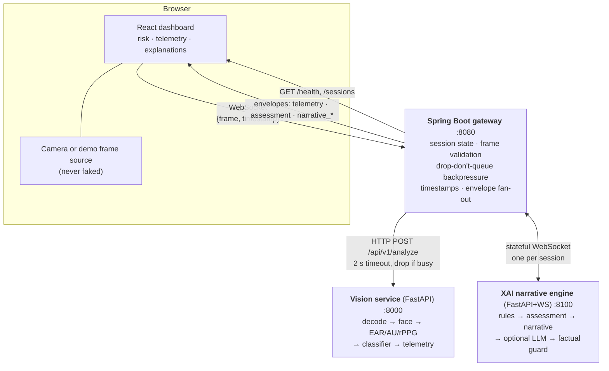

# Pre-attentive cognitive fatigue detection

A real-time monitoring prototype that detects the **early, pre-attentive stage of
cognitive fatigue** — where visual attention starts to degrade while the eyes are
still open — and explains its reasoning in plain language.

The premise is that a classifier's fatigue probability is *late*: eyelid droop and
facial strain move first. This system therefore treats the model as one signal among
several, combines them with a deterministic rule engine, and reports which signals
actually agreed.

> **Research prototype — not a medical device.** It reports a risk *indicator* from
> behavioural signals. It is not clinically validated and must not be used as the
> sole basis for driving or safety decisions.

**What makes it distinctive**

* **Provenance-aware AI.** Every value carries how it was obtained — `live`,
  `synthetic`, `estimated`, `unavailable`, `not_detected`, `not_configured` — from
  the sensor through to the sentence the LLM writes. The system cannot describe a
  synthetic measurement as a real driver.
* **Grounded explanations.** The deterministic findings and the natural-language
  explanation appear side by side, and a factual guard discards any sentence that
  contradicts the findings.
* **Latency-aware streaming.** Frames are dropped rather than queued, and the drop
  counters, achieved rate and inference latency are all on screen.
* **Graceful AI degradation.** Groq (or Ollama, or any OpenAI-compatible server) is
  optional by construction: a provider outage changes the wording, never the
  assessment.
* **Operational diagnostics.** A broken vision service, a missing model, a dead
  narrative bridge and a rejected API key each surface as a distinct named state.
* **Reproducible demonstrations.** Synthetic mode needs no key, model, GPU or
  network; the same codebase runs real inference and a real LLM without
  misrepresenting which one is active.

---

## Architecture



### Data flow

1. The browser captures a frame (or, in demo mode, a blank placeholder) and sends
   `{frame, timestamp}` over a WebSocket — **skipping the frame entirely** if the
   socket is still backed up.
2. The gateway validates, normalises the timestamp to strictly-increasing epoch
   seconds, and calls the vision service. **If a vision call is still running when
   the next frame arrives, that frame is dropped, never queued.**
3. The vision service decodes, locates a face, extracts whatever signals it can, and
   returns one telemetry row carrying `mode` and per-metric `signal_status`.
4. The gateway sends the telemetry to the browser immediately, and offers the same
   frame to the narrative engine on a long-lived per-session socket.
5. The narrative engine runs the rule engine, produces an `assessment` every ~2 s,
   and — when the risk level changes or a trend persists — generates a narrative.
   If an LLM is configured, its draft is validated against the deterministic facts
   and **replaced by a template if it disagrees with them**.
6. The gateway relays those events to the browser with their payloads intact.

---

## Technology stack

| Layer | Technology |
|---|---|
| Frontend | React 18, TypeScript (strict), Vite, Tailwind CSS, Recharts, Vitest |
| Gateway | Java 17, Spring Boot 3.4, Spring WebSocket, Spring WebFlux (client), Maven |
| Vision | Python 3.11+, FastAPI, Pydantic v2, NumPy, Pillow, optional ONNX Runtime |
| XAI engine | Python, FastAPI, Pydantic v2, WebSockets, optional Ollama / OpenAI-compatible LLM |
| Orchestration | Docker Compose, nginx (frontend), healthchecks, non-root containers |
| Transport | WebSocket (browser↔gateway, gateway↔narrative), HTTP (gateway→vision) |

No database, no message broker, no reactive web server, no scheduled jobs. Every
piece of state is per-session and in memory, and is released when the socket closes.
That is a deliberate constraint, not an omission.

---

## Running locally

Four processes. Prerequisites: **JDK 17+**, **Python 3.11+**, **Node 20+**.

```bash
# 0. Configuration (optional — every default is safe)
cp .env.example .env

# 1. Python dependencies (one virtualenv for both services)
python3 -m venv .venv && .venv/bin/pip install -r xai_narrative/requirements.txt -r vision_service/requirements.txt

# 2. Vision service  -> http://localhost:8000
VISION_MODE=stub .venv/bin/python -m vision_service.app

# 3. XAI narrative engine  -> http://localhost:8100
cd xai_narrative && NARRATIVE_LLM=none ../.venv/bin/python -m fatigue_xai.api

# 4. Gateway  -> http://localhost:8080
cd gateway && mvn spring-boot:run

# 5. Frontend  -> http://localhost:5173
cd frontend && npm install && npm run dev
```

Then open <http://localhost:5173>. It starts in **demo mode**: no camera, no model,
no API key, no GPU.

Verify the stack is wired correctly:

```bash
curl -s localhost:8000/health   # vision: mode, model state, signal providers
curl -s localhost:8100/health   # narrative: llm mode, session count
curl -s localhost:8080/health   # gateway: sessions, frames, downstream (observed)
```

`/health` on the gateway reports downstream services from **observed traffic only** —
it never probes. `"degraded": null` means *nothing has been attempted yet*, which is
deliberately distinct from a claim of health.

---

## Running with Docker

```bash
docker compose up --build
# dashboard: http://localhost:5173
```

Five services are defined: `frontend` (nginx), `gateway`, `vision`, `narrative-xai`,
and an optional `ollama` behind a profile (`docker compose --profile llm up --build`).

All images run as non-root and every service has a container healthcheck.

To run real inference in a container, switch the vision service to ONNX mode and mount
the model directory holding the `.onnx` and `.onnx.data` pair together:

```yaml
vision:
  environment: { VISION_MODE: onnx, FATIGUE_ONNX: /models/efficientnet_fatigue.onnx }
  volumes: ["./models:/models:ro"]
```

---

## Configuration

See [`.env.example`](.env.example) for every variable with its safe default. The ones
that matter most:

| Variable | Default | Effect |
|---|---|---|
| `VISION_MODE` | `stub` | `stub` = synthetic demo telemetry; `onnx` = real inference |
| `VISION_FALLBACK_TO_STUB` | `false` | Whether ONNX mode may fall back to stub. `false` means a broken model reports **degraded** and refuses to serve synthetic data |
| `NARRATIVE_LLM` | `none` | `none` (deterministic templates), `groq`, `ollama`, `openai` |
| `GROQ_API_KEY` / `GROQ_MODEL` | unset | Required together for `NARRATIVE_LLM=groq`. Unset is a *disabled provider*, not a startup failure |
| `GROQ_TIMEOUT_SECONDS` | `8` | Response deadline for one explanation; validated at startup |
| `GROQ_MAX_TOKENS` | `200` | Output cap for one explanation. `gpt-oss`-style reasoning models need much more — see the Groq section |
| `GATEWAY_MAX_FRAME_BYTES` | `524288` | Handler frame limit. See the two-ceiling note in `.env.example` |
| `GATEWAY_MAX_SESSIONS` | `32` | Concurrent session ceiling; a further connection is closed with `1013` and a reason |
| `GATEWAY_SESSION_TAKEOVER_GRACE_MS` | `5000` | How long an incumbent session must be silent before another connection may claim its id |
| `GATEWAY_ALLOWED_ORIGINS` | localhost only | Origins permitted to open the WebSocket |
| `VISION_PORT` / `XAI_PORT` | `8000` / `8100` | Bind ports. `0` or a non-numeric value is a **startup error**, never a silent random port |
| `VITE_GATEWAY_WS` | `ws://localhost:8080` | Gateway URL baked into the frontend build |
| `FATIGUE_ONNX` | – | Path to the exported classifier (`VISION_MODE=onnx` only) |

The frontend can also be pointed anywhere without a rebuild:
`http://localhost:5173/?gateway=ws://other-host:8080&session=operator-042`.

---

## Configuring an LLM provider (Groq)

Two independent decisions, and the dashboard is explicit about which combination is
running — neither choice implies the other:

| | Vision (`VISION_MODE`) | Narrative (`NARRATIVE_LLM`) |
|---|---|---|
| **Mode A — synthetic demo** | `stub`: deterministic generator, no model, no GPU | `none`: deterministic templates, no key, no network |
| **Mode B — real explanations** | any (the rule engine is real either way) | `groq` (or `ollama` / `openai`) |
| **Mode B+ — real inference** | `onnx` + a model file → `LIVE VISION` | either |

The API key lives in the XAI service only. It is read server-side and never reaches
the browser: it is not a `VITE_*` variable, it appears in no API response, and
`GroqClient` redacts it from provider messages before they can reach a log line,
`/health` or the dashboard.

### Setup

1. Get a key from the [Groq console](https://console.groq.com/) and note a model
   your account supports.
2. Put it in your untracked `.env` (`.env` is gitignored; `.env.example` carries
   placeholders only):

   ```dotenv
   NARRATIVE_LLM=groq
   GROQ_API_KEY=your_key_here
   GROQ_MODEL=a_model_your_account_supports
   GROQ_BASE_URL=https://api.groq.com/openai/v1
   GROQ_TIMEOUT_SECONDS=8
   GROQ_MAX_TOKENS=200
   ```

   `GROQ_MODEL` has no default on purpose: the catalogue changes, and a stale
   hard-coded name fails confusingly instead of clearly. A malformed timeout or
   token limit is a configuration error, not a silent fallback to the default.

   A **reasoning** model (Groq's `gpt-oss` family, for example) needs a much larger
   `GROQ_MAX_TOKENS`: its chain of thought streams on a channel the client ignores,
   but those tokens still count against the same cap — at the 200 default a complete
   2–3 sentence answer can come back truncated or empty. Observed live with
   `openai/gpt-oss-20b`: 2000 produced complete answers that passed the guard. A
   truncated answer is rejected by the guard, never published.
3. Start the service: `NARRATIVE_LLM=groq .venv/bin/python -m fatigue_xai.api`.
   A missing key or model is **not** fatal — the provider reports `enabled: false`
   and narratives come from the deterministic template.
4. Check the provider's observed state:
   `curl -s localhost:8100/health` — `provider.enabled`, `provider.model`,
   `provider.calls`, `provider.failures`, `provider.last_error_kind`. An external
   provider is never probed by `/health`, so a monitoring loop cannot spend quota.
5. Run the live smoke test (it uses your key; exit `2` = environment incomplete,
   `1` = a check failed): `.venv/bin/python scripts/groq_smoke.py`. It checks
   reachability and credentials, a real grounded generation through the guard, the
   guard's independence from the provider's good behaviour, and classification of a
   bad model name.
6. Start a monitoring session. When the model wrote the text, the narrative panel
   shows `Explanation source: groq:<model>` with status `OK`.
7. Prove the fallback. Re-run with an invalid key and the panel shows
   `Unavailable` with a plain-language reason and a `fallback: template_fallback`
   badge — **while the risk assessment keeps updating**. The smoke test reports the
   same failure as `unauthorized` rather than a generic error.

Local alternative, same architecture — no account needed:
`NARRATIVE_LLM=ollama OLLAMA_MODEL=…` against a local Ollama server, or
`NARRATIVE_LLM=openai OPENAI_COMPAT_URL=…` for vLLM/llama.cpp.

### What the engine does with the answer

```
assessment facts ──▶ prompt ──▶ provider ──▶ factual guard ──▶ accepted ──▶ narrative_final
                                                │
                                                └── rejected / failed ──▶ deterministic template
```

* The prompt carries the deterministic facts *and their provenance*, and instructs
  the model to state only those facts.
* The guard re-checks the answer against the same facts: risk level, every number,
  AU codes, trend direction, prohibited medical/advice wording, and — for synthetic
  input — wording that claims a real driver was observed. It is not a second LLM
  and needs no network.
* `CRITICAL` and `UNKNOWN` never call the provider at all (`llm_status: skipped`,
  `bypass_reason: critical_or_unknown_risk`): a critical verdict must not wait on a
  network round trip.
* At most one retry, only for a plausibly transient failure (timeout, connection,
  5xx, rate limit) and only before any text has been streamed. Every failure is
  classified (`unauthorized`, `rate_limited`, `model_not_found`, `timeout`, …) so
  the panel can say what actually went wrong.

**LLM failure is never fatigue-detection failure.** The assessment, findings and
telemetry keep flowing; only the phrasing changes.

---

## WebSocket contract

[`CLIENT_CONTRACT.md`](CLIENT_CONTRACT.md) is authoritative. It defines the frame
message, every envelope type, and the narrative panel rules (`narrative_chunk` is
**provisional**; `narrative_final` **replaces** the panel). The TypeScript half of the
contract lives in [`frontend/src/types.ts`](frontend/src/types.ts) — if a field is
renamed in one, it must be renamed in the other in the same change.

Two fields exist so the dashboard cannot mislead: every telemetry row carries

```json
{ "mode": "stub", "signal_status": { "ear": "synthetic", "rppg_bpm": "not_configured" } }
```

`mode` is `stub` or `onnx`; `signal_status` gives per-metric provenance using
`live`, `synthetic`, `estimated`, `unavailable`, `not_detected`, `not_configured`.
The UI renders the provenance next to every value, and never assumes a missing value
is live.

---

## Security model

What is enforced today, and what is deliberately out of scope for a local research
console:

| Control | State |
|---|---|
| Session id ownership | A second connection claiming an id that is still active is **rejected**, never allowed to evict the incumbent. Takeover is possible only after `GATEWAY_SESSION_TAKEOVER_GRACE_MS` of silence, because a socket left behind by a dropped network is indistinguishable from a live client until it stops sending |
| Admission ceiling | `GATEWAY_MAX_SESSIONS` (default 32); beyond it connections are closed with `1013` and a reason. At ~576 KiB of buffer per session this bounds the memory one client can pin |
| Ownership-guarded teardown | Cleanup is keyed on socket identity, not on the id — otherwise rejecting an intruder would deregister the legitimate session (an integration test caught exactly that) |
| Origin check | `GATEWAY_ALLOWED_ORIGINS` (localhost by default). This stops a *browser* on another origin opening the socket; it is not authentication, because any non-browser client sets `Origin` itself |
| Frame validation | Size (two ceilings), JSON shape, timestamp normalisation. A malformed or oversized frame costs a frame, not the session |
| Credential handling | The Groq key is server-side only, and provider messages are redacted before they can reach a log, `/health`, an error payload or the dashboard |
| Provenance enforcement | Synthetic data may not be narrated as an observation of a person — enforced in code (`compose`) and in the guard, never left to prompt wording |

**Not implemented, and not claimed:** authentication, per-operator accounts, TLS
termination and rate limiting. A session id is public knowledge (it is in the URL),
so it is not a substitute for authentication. Before exposing the gateway beyond
localhost: put an authenticating reverse proxy in front of it, set
`GATEWAY_ALLOWED_ORIGINS` to the real origin, and terminate TLS at the proxy.

---

## Testing

```bash
# Gateway — 63 tests (unit + Spring integration + live WebSocket end-to-end)
cd gateway && mvn test

# Vision service — 54 tests
.venv/bin/python -m pytest vision_service/tests -q

# XAI narrative engine — 229 tests (5 skipped without FATIGUE_ONNX)
.venv/bin/python -m pytest xai_narrative/tests -q

# Frontend — 59 tests (state machine, narrative rules, backpressure, contracts)
cd frontend && npm test && npm run typecheck && npm run build
```

Totals at the last run: **63 + 54 + 229 + 59 = 405 passing**, 5 skipped.

### What the suites deliberately do not cover

* **Real ONNX inference** is not tested, because the weights are not in the
  repository (`models/` is gitignored and mounted at run time). Every inference
  claim in this README is therefore about the *pipeline*, not about a
  validated model. See [Limitations](#limitations).
* **The real Groq API** is not exercised by the suite. Provider tests use
  `httpx.MockTransport`, so they need no account and cost nothing. The live check
  is separate and explicitly labelled:

  ```bash
  export GROQ_API_KEY=...      # never commit this
  export GROQ_MODEL=...        # a model your account supports
  .venv/bin/python scripts/groq_smoke.py
  ```

  It exits `2` when the environment is incomplete, `1` on a failed check, and
  prints the classified reason (`unauthorized`, `rate_limited`, `model_not_found`)
  rather than a generic failure. Running it with a deliberately invalid key is a
  useful check in itself: it reaches the real endpoint and confirms that the
  request shape is right and that a rejected key is classified as such.
* **Visual regression.** The frontend tests cover logic, not rendering; no
  component snapshot or screenshot test exists.
* **Cross-browser behaviour.** The dashboard is exercised in Chromium only.

End-to-end smoke test — drives the whole pipeline and prints a PASS/FAIL report:

```bash
.venv/bin/python scripts/smoke_test.py
```

```
CONNECT         PASS  handshake with ws://localhost:8080/ws/video/smoke-1
FRAME SEND      PASS  1200 valid frames in 81.9s (14.6 fps)
ENVELOPE        PASS  1253 messages, all with the four envelope fields
TELEMETRY       PASS  1202 rows; mode=stub p_fatigue=0.141 face_detected=True
NARRATIVE       PASS  10 narrative events; sources=['template', ...]
ASSESSMENT      PASS  41 assessments; levels seen: ['HIGH', 'MODERATE']
BACKPRESSURE    PASS  received=1287 processed=1202 dropped=83 unparseable=2
                      vision_errors=0 unaccounted=0 — drop-don't-queue observed
BURST           PASS  80 frames sent in 8 ms (vs 5333 ms paced)
ERROR HANDLING  PASS  malformed/empty/oversized frames rejected; session survived
HARD LIMIT      PASS  container closed the connection above its ceiling
DISCONNECT      PASS  session 'smoke-1' released by the gateway

E2E RESULT: PASS
```

The backpressure check is the interesting one: the browser cannot see dropped frames
(they produce no message by design), so the script bursts frames far faster than the
pipeline can answer and then reconciles its own counts against `GET /sessions`:

```
framesReceived == framesProcessed + framesDropped + unparseable + telemetryErrors
```

`unaccounted=0` is the property being tested — nothing is silently lost.

---

## Performance measurements

Every figure below came from a run in this repository and is reproducible with the
commands in [Testing](#testing).

| Measurement | Observed | How it was measured |
|---|---|---|
| Paced frame loop | 1200 frames in 81.9 s (14.6 fps) | `scripts/smoke_test.py` |
| Backpressure under a burst | received=1287 processed=1202 dropped=83 unparseable=2, `unaccounted=0` | `scripts/smoke_test.py`, reconciled against `GET /sessions` |
| Burst send | 80 frames in 8 ms — the pipeline answered at its own rate and dropped the rest | `scripts/smoke_test.py` |
| Gateway suite | 63 tests, ~10 s | `mvn -o -B test` |
| Narrative engine suite | 229 tests, ~15 s | `pytest xai_narrative/tests` |
| Vision suite | 54 tests, <1 s | `pytest vision_service/tests` |
| Frontend suite | 59 tests, ~0.5 s | `npx vitest run` |
| Production build | ~7 s; 57 kB app + 451 kB charts (139 kB gzipped) + 16 kB CSS | `npm run build` |

Drop-don't-queue is why the burst figure is not a latency problem: the gateway never
queues under load, so latency stays bounded at the cost of missing frames — and the
missing frames are *counted* rather than hidden.

---

## Demo mode vs live mode

**Demo mode** (`VISION_MODE=stub`, the default) needs no camera, GPU, model file or API
key. A deterministic sawtooth generator ramps the fatigue drive over 75 s and resets
every 120 s, so a demo repeatedly escalates `LOW → MODERATE → HIGH` and recovers —
which is also what exercises the engine's downgrade hysteresis. Every value is labelled
`synthetic`, the dashboard shows a **DEMO / SYNTHETIC** badge, and the camera panel says
plainly that no image data exists.

**Live mode** requires `VISION_MODE=onnx` and a valid model. The dashboard shows
**LIVE VISION** only when the telemetry itself reports `mode: "onnx"` — the badge is
driven by the pipeline, not by configuration. If the model is missing and
`VISION_FALLBACK_TO_STUB=false`, `/health` reports `degraded` and the API answers 503
rather than inventing telemetry.

Independently of the vision mode, the narrative panel names the provider it actually
used (`groq:<model>`, `ollama:<model>`, `none configured`) and its status (`OK`,
`Unavailable`, `Skipped`, `Rejected by guard`, `Not configured`). A
`fallback: …` badge (`fallback: template` with no provider configured,
`fallback: template_fallback` after a provider failure or guard rejection) means the
text on screen is the deterministic explanation — the assessment above it is
unchanged.

---

## Design decisions

* **The gateway is not a reactive server.** WebFlux is used *only* for the outbound
  vision call (`WebClient`/`Mono`, one request per frame, 2 s timeout). Inbound it
  is MVC/Tomcat, because WebSocket fan-out is stateful and blocking and a reactive
  server would buy concurrency this workload does not need.
* **Frames are dropped, not queued.** A `compareAndSet(false, true)` in-flight flag
  means a frame arriving during vision processing is dropped. In a monitoring
  pipeline a stale frame is worse than a missing one, and a queue would convert a
  slow model into unbounded latency and memory. Drops are counted and reconcilable
  via `/sessions`.
* **Risk classification stays deterministic.** A model may phrase an assessment,
  never decide it: rules, thresholds and hysteresis are code — testable and
  independent of any provider's availability.
* **The LLM only explains.** It receives validated facts with provenance, and the
  guard rejects anything contradicting them, so a fluent wrong sentence cannot
  become a factual claim.
* **Provenance reaches the narrative engine.** Without it the dashboard knows a
  measurement is synthetic while the prose describes a driver. `mode` and
  `signal_status` are carried through the gateway DTO, the XAI schema, the facts
  view, the guard and the final text.
* **Driver video is not persisted.** Frames exist in memory for one request: no
  disk, no image database, no frame logging, no raw imagery to any LLM.
* **Synthetic telemetry cannot support claims about a real driver.** The simulation
  marker is prepended by the composer in code, so it survives templates, LLM output
  and fallbacks alike, and the guard rejects person-claiming wording on synthetic
  input.
* **A model file does not imply a validated model.** The ONNX path is wired and its
  preprocessing/softmax come from one shared definition, but no accuracy is claimed
  without an evaluation on an appropriate dataset (see [Limitations](#limitations)).

---

## Troubleshooting

| Symptom | Where to look |
|---|---|
| Dashboard stuck on `connecting` / `reconnecting` | Is the gateway up (`curl -s localhost:8080/health`)? Is the origin allowed (`GATEWAY_ALLOWED_ORIGINS`)? The app reports the close code and whether the failure is permanent |
| `DEMO / SYNTHETIC` while expecting live inference | The telemetry itself says `mode: "stub"` — either `VISION_MODE` is not `onnx`, or the model failed and fallback is enabled |
| Diagnostics show `vision: degraded` and no telemetry | `curl -s localhost:8000/health` for `status`, `model_loaded`, `load_error` and `degraded`. A missing or invalid model with `VISION_FALLBACK_TO_STUB=false` is the designed behaviour (503, not synthetic data) |
| Narrative panel shows `Unavailable` | `curl -s localhost:8100/health` → `provider.last_error_kind`: `unauthorized` = key, `model_not_found` = `GROQ_MODEL`, `rate_limited` = account limit |
| No narrative at all | Narratives are produced on level change, escalation, a new finding or a persistent trend — a steady LOW is quiet by design |
| `NARRATIVE_LLM=… is not a known provider` | Only `none`, `groq`, `ollama` and `openai` are accepted |
| The service refuses to start on a port error | That is intentional: `PORT=0`, `PORT=abc` or an out-of-range value is a configuration error. Set `VISION_PORT` / `XAI_PORT` |
| Import error about `fatigue_xai` | The vision service could not locate the sibling package; set `XAI_NARRATIVE_PATH` to the directory containing it |

---

## Limitations

Stated plainly, because the alternative is a system that looks more capable than it is.

- **The deployed model is not the research architecture.** `efficientnet_fatigue.onnx`
  is a *frame-level 3-class classifier* (microsleep / neutral / yawning). It is not
  TimeSformer or a 3D-CNN, and it has no temporal receptive field of its own — all
  temporal reasoning lives in the rule engine's sliding windows.
- **Real inference is not verified.** No ONNX model was available in the development
  environment, so the ONNX path is exercised only with a stub classifier and the real
  preprocessing/softmax code. Classification performance on real drivers is unknown.
- **EAR is measured only where MediaPipe FaceMesh is installed**, and its absolute
  values are **not comparable** to the thresholds in `rules.default.json`, which assume
  a different landmark scheme. The engine's *relative* per-user baseline is what makes
  them usable.
- **FACS AU intensities and rPPG heart rate are not implemented.** They are reported as
  `not_configured` / `null`. The narrative guard rejects any explanation that mentions
  them, because the fact is absent from the deterministic rule set.
- **Face detection has a fallback that is not detection.** A centre crop is reported as
  `face_detected: false` with `face_detection: "centre_crop"`, and no fatigue
  probability is derived from it — a classifier applied to a region that was never
  confirmed to contain a face produces a number that means nothing.
- **Rules and thresholds are heuristics**, not validated clinical cut-offs.
  `rules.default.json` can be overridden via `RULES_JSON` and should be recalibrated
  per deployment.
- **Browser tabs throttle timers when hidden.** Chrome clamps background timers to
  roughly 1 Hz, so a backgrounded dashboard genuinely captures ~1 fps. The panel
  measures and displays the achieved rate rather than the target, and says so.
- **Docker images were not built or run** in this environment (Docker was unavailable).
  The compose file parses and is internally consistent, but `docker compose build/up`
  is **unverified**.
- **Docker/ONNX/full-browser verification** require a machine with Docker and a model
  file; they are not part of the checked-in test suites.

---

## Privacy

This system processes camera frames, so the defaults are deliberately conservative:

- Frames are **processed transiently in memory**. Nothing is written to disk, and there
  is no image database and no session recording.
- Only **numeric telemetry** leaves the vision service. A raw frame is never sent to an
  LLM, and no image data is ever included in a narrative prompt.
- Logs contain identifiers, sizes and latencies — **never base64 frames or pixel
  content**.
- If you configure an external LLM, only the derived facts (risk level, numeric
  features, rule findings) are sent, never imagery.
- Session state (timestamps, counters, narrative windows) is released when the socket
  closes.

---

## Research caveats

The literature concept this project is built around is **pre-attentive fatigue
detection** — identifying attention degradation before eye closure. What is actually
implemented is a *rule-based approximation* of that idea:

- Eye openness and facial strain are weighted **earlier** than the classifier
  probability, and the ordering is explicit in the code and testable
  (`vision_service/stub.py`, and the engine's `early_drift` rule path).
- Rule evaluation is the **source of truth** for every safety fact. The LLM's only role
  is phrasing; its output is validated against the deterministic facts and discarded in
  favour of a template when it disagrees.
- Risk levels use corroboration and persistence (hysteresis) rather than instantaneous
  probability, so a single good frame cannot drop `HIGH → LOW`.

None of this constitutes clinical validation, and the project makes no claim about
real-world detection performance.
